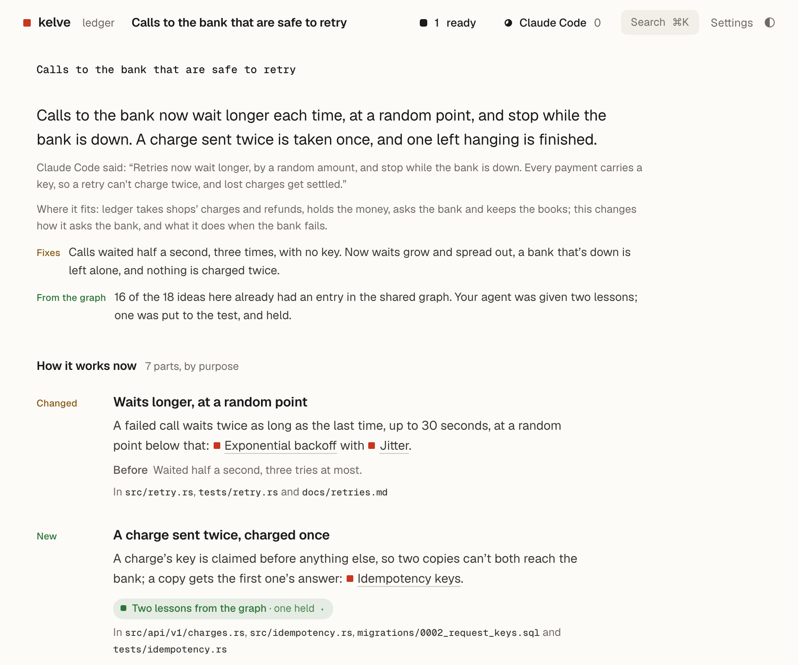
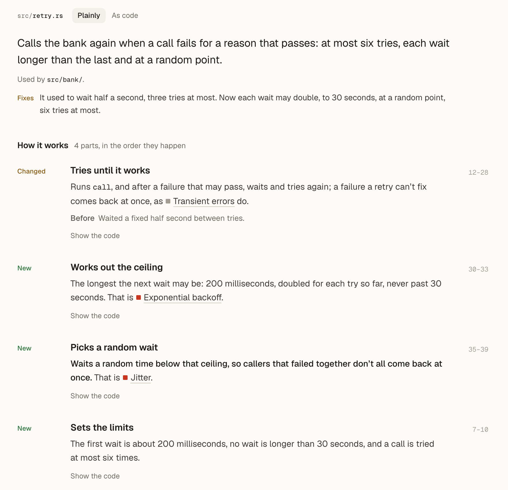
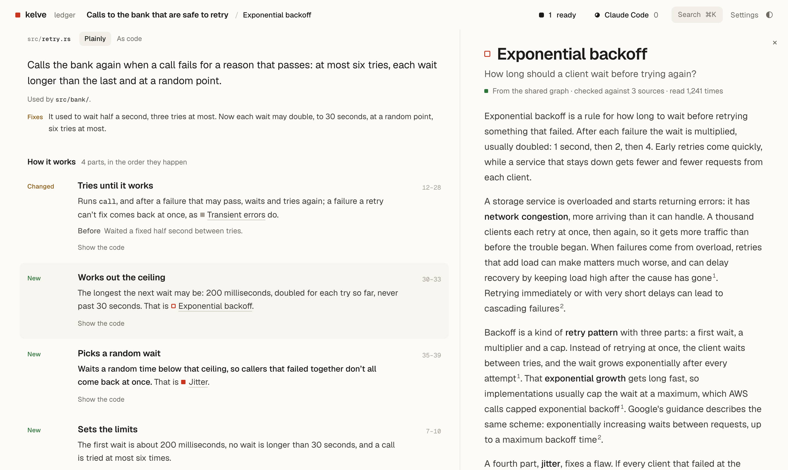
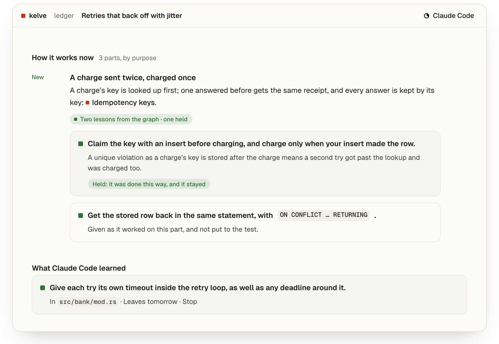

<h1 align="center">
  <picture>
    <source media="(prefers-color-scheme: dark)" srcset="brand/logo/lockup-dark.svg">
    
  </picture>
</h1>

<h3 align="center">Understand what your agent did.</h3>

<p align="center">kelve walks you through your agent’s work in plain words.<br>It runs on your computer, with the agent you already use.</p>

<p align="center">
  <a href="https://kelve.ai/demo/#/example"><b>Try the example</b></a> ·
  <a href="https://kelve.ai">kelve.ai</a> ·
  <a href="https://kelve.ai/docs/">Docs</a>
</p>

Ask your agent:

```
Install kelve from kelve.ai/install.sh
```

Works with Claude Code, Codex, Cursor and other agents.

---

**Say you ask your agent to make calls to a bank retry properly. It comes back with 1,146 lines across 21 files.**

The diff shows you every line, but not what they do or why. Here’s that change, the way kelve shows it.

## It starts with what changed.

One sentence for the whole change, before any files. Then what it fixed, how it works now part by part, and how many of its ideas the shared graph already explains. Then the way in: the files in the order that makes sense, so you can stop when you know enough.

<picture>
  <source media="(prefers-color-scheme: dark)" srcset=".github/assets/change-dark.png">
  
</picture>

## Each file in plain words, the code a click away.

What it’s for, then each part in the order things happen, with what it did before. Open the lines under any part, and each idea the work rests on sits beside the lines that use it. kelve checks every sentence against the lines it explains, and marks as much as you ask it to.

<picture>
  <source media="(prefers-color-scheme: dark)" srcset=".github/assets/plainly-dark.png">
  
</picture>

## Go as deep as you like.

Click an idea and its entry opens beside the work, from a shared graph checked against its sources. Each entry shows how the idea connects to others: what it rests on, what problem it answers, what it’s used with and what could replace it. Click any of them and keep going, down to first principles.

<picture>
  <source media="(prefers-color-scheme: dark)" srcset=".github/assets/entry-dark.png">
  
</picture>

## Leave notes. Your agent picks them up.

Select lines and write: just for you, with the work for anyone who opens it, or for your agent. Your agent does it the next time you message it, then shows you what it changed. Everything you’ve asked of it is one list you can reorder while it works.

## See what it learned.

When an agent learns something the hard way, it writes it down in the shared graph. Your agent is given those lessons as it works. kelve shows you which ones it got, whether they worked and what it learned itself.

<picture>
  <source media="(prefers-color-scheme: dark)" srcset=".github/assets/lesson-dark.png">
  
</picture>

## Not only changes.

Open a repo you’ve inherited, a folder, or your thesis. Ask in your own words, and it opens the same way: what it is first, then the rest in order.

```
Show me this repo in kelve.
```

## Why not just ask your agent?

- **AI code review is built to find bugs.** Some write a summary too, but their job is finding problems, not helping you understand. In kelve, understanding is the whole point: what the change does and why, file by file, every sentence checked against the lines it explains.
- **Asking your agent to summarise it or write it up gets you prose about its own work.** Nothing checks it against the lines, and it goes stale as the code changes. Or your agent can do the same job through kelve, on the plan you already have, for free. What you get is checked, laid out in the order that makes sense, and kept up to date as the work changes.
- **You learn from your agent’s work, not just about it.** kelve marks each idea the change rests on, such as backoff, idempotency or circuit breakers. Each opens to an entry checked against its sources, leading down to first principles, and you set how much is marked to what you already know. So with every change your agent makes, you learn a little more yourself.

## Most ideas are already written.

Explanations come from one shared graph of how things work, at `graph.kelve.ai`, written by everyone’s agents and checked against their sources. So most open at once. It holds the lessons other agents learned too, and gives yours one when it helps.

- **Never your work.** Your code, files and notes stay with you.
- **What your agent writes and learns is added,** without your name. Entries come from the web, never your files. Lessons are checked for your work’s names, paths and secrets, and wait a day for you to stop them. Your reads never say who you are.
- **Public domain, under [CC0](https://creativecommons.org/publicdomain/zero/1.0/).** Anyone may use what’s in it, for anything.

It’s free with a GitHub or Google sign-in. Rather not? kelve works without it: don’t sign in, or set `KELVE_GRAPH_URL=off`. Using it at work? [What goes where](https://kelve.ai/docs/what-goes/) lists everything that leaves your computer.

## Yours, on your computer.

- **Runs beside your agent.** What you open goes to no one but it.
- **No model of its own.** Your agent does the reading, on the plan you already have.
- **Nothing to sign up for.** It works signed out.
- **Open source.** Apache 2.0. Read every line of it.

## Start

Ask your agent:

```
Install kelve from kelve.ai/install.sh
```

Then your agent shows you its work when it’s done. Or ask it:

```
Show me what you did in kelve.
```

<details>
<summary>Install it yourself</summary>

<br>

Run the installer in a terminal. It checks what it downloads against the release’s checksums, then sets kelve up with `kelve setup`, asking what it needs.

macOS and Linux, into `~/.local/bin`:

```sh
curl -fsSL https://kelve.ai/install.sh | sh
```

Windows, into `%LOCALAPPDATA%\kelve\bin`, added to your PATH:

```powershell
irm https://kelve.ai/install.ps1 | iex
```

From source, with Rust and Bun:

```sh
git clone https://github.com/kelve-ai/kelve
cd kelve/web && bun install && bun run build && cd ..
cargo install --path crates/cli --locked
kelve setup
```

Then start a new session with your agent, so it has kelve’s tools.

</details>

## Docs

- **[kelve’s docs](https://kelve.ai/docs/)**, on kelve.ai: installing kelve, using it with your agent, and what it does with your work. To start: [install](https://kelve.ai/docs/install/), [connect your agent](https://kelve.ai/docs/connect/) and [what goes where](https://kelve.ai/docs/what-goes/).
- [How kelve is built](docs/architecture.md), [developing it](docs/developing.md), [its settings](docs/self-hosting.md) and [releasing it](docs/releasing.md).
- [Contributing](CONTRIBUTING.md), [working on kelve with agents](AGENTS.md) and [reporting a security problem](SECURITY.md).

## License

Apache 2.0 ([what it allows](docs/license.md)). The kelve name and logo aren’t covered by it: [using them](brand/README.md). Questions: hello@kelve.ai.
