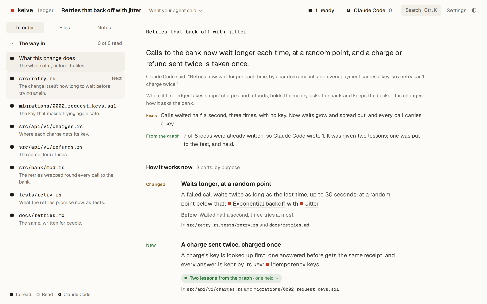
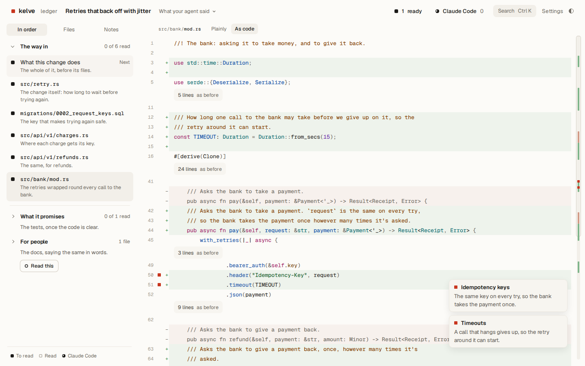
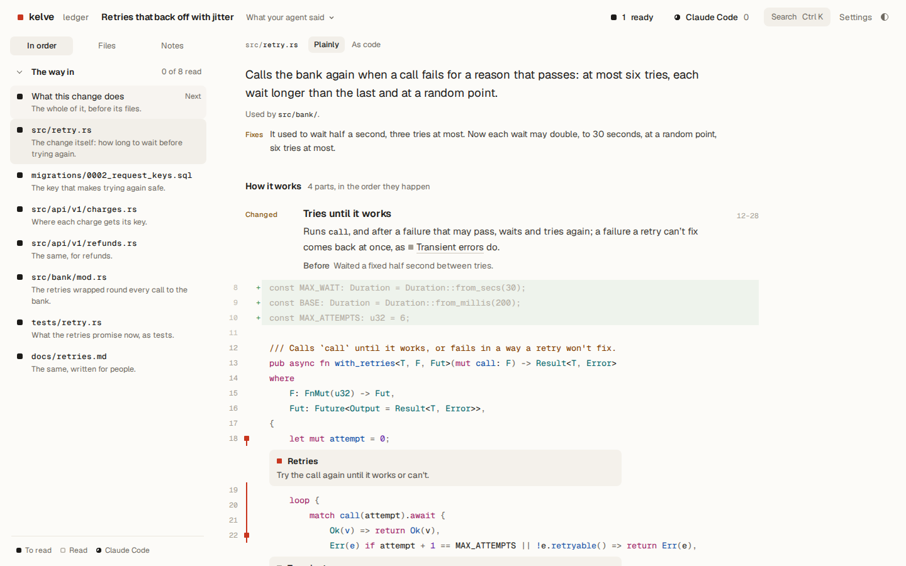
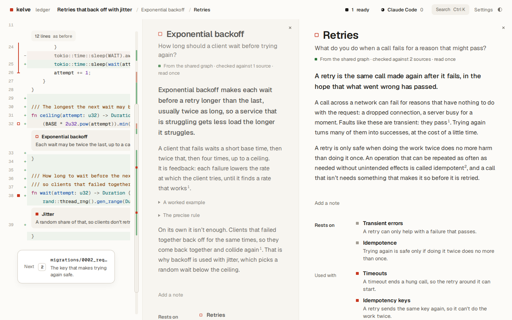
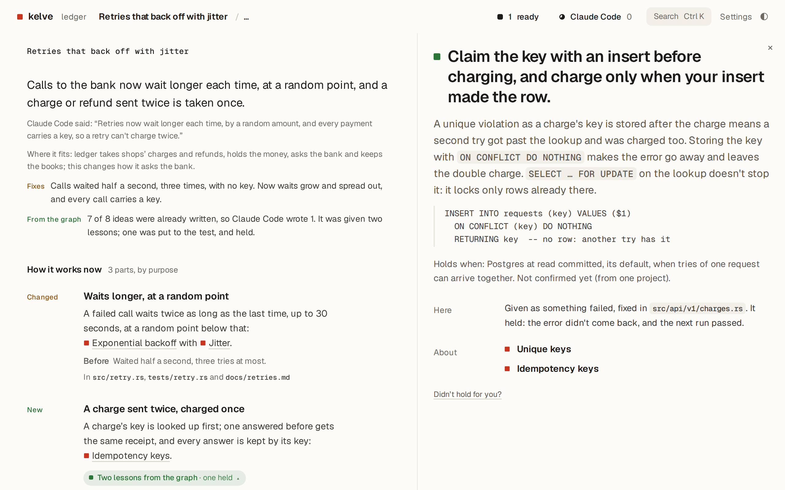

<h1 align="center">
  <picture>
    <source media="(prefers-color-scheme: dark)" srcset="brand/logo/lockup-dark.svg">
    
  </picture>

</h1>

<h3 align="center">Understand what your agent did, quickly.</h3>

<p align="center">kelve opens your agent’s work in plain words, part by part, with each idea down to first principles. It runs on your computer, with the agent you already use.</p>

<p align="center">
  <a href="https://kelve.ai/docs/"><b>Docs</b></a> ·
  <a href="https://kelve.ai/demo/#/example">Try the example</a> ·
  <a href="https://kelve.ai">kelve.ai</a>
</p>

Ask your agent:

```
Install kelve from kelve.ai/install.sh
```

Then, when it's done something:

```
Show me what you did in kelve.
```

Your agent shows you its work in kelve by itself, as it hands it over: when it commits, pushes or opens a pull request.

<picture>
  <source media="(prefers-color-scheme: dark)" srcset=".github/assets/change-dark.png">
  
</picture>

This is kelve itself, on an example: a change an agent made to a payments service. It opens on what the change does, with In order beside it. Open a step, an idea or a folder, or leave a note: [open the example](https://kelve.ai/demo/#/example).

## Read it in order.

Whatever your agent opens, a change, a repo or a folder, it finds the way in first: what it is, then the files in the order that lets each build on the one before, and the rest in parts.

It reads along the way, so you can start at once, and stop when you know enough. A filled square is ready for you; hollow, you’ve read it.

<picture>
  <source media="(prefers-color-scheme: dark)" srcset=".github/assets/in-order-dark.png">
  
</picture>

[See it in the example →](https://kelve.ai/demo/#/example?f=src%2Fbank%2Fmod.rs&r=code&t=order&as=path)

## Every part, in plain words.

Your agent writes each page to the same rules, and kelve checks every part against the lines it explains before you see it.

1. **What it’s for comes first,** in one sentence, for the whole file.
2. **Each part is named by its goal,** in the order things happen.
3. **Then what it does, and what for,** in a sentence or two.
4. **What it did before,** where your agent changed it.
5. **A specialist word is an idea.** Open it to learn it.
6. **The code it explains** is a click away, with what changed.

<picture>
  <source media="(prefers-color-scheme: dark)" srcset=".github/assets/plainly-dark.png">
  
</picture>

[Read this file plainly in the example →](https://kelve.ai/demo/#/example?f=src%2Fretry.rs&r=plainly)

## Anything your agent opens.

Code or words: a repo, a thesis, your notes, one file, or just what your agent did. Ask in your own words, and it opens there in kelve, the same way each time: what it is first, then the rest in order.

## Your agent does the reading.

kelve has no model and no key of its own. It runs on your computer, beside your agent, and gives it the reading to do.

- **No model of its own.** Claude Code, Codex, Cursor or any other agent reads your work and writes every page, on the model and plan you already have.
- **On your computer.** kelve runs beside your agent. What you open goes to no one but it.
- **Only what you’ll read.** It reads the way in first, and the rest when you ask. Its dial, at the top of every page, shows it working, and opens its list.
- **Nothing to sign up for.** kelve works signed out. Sign in only to join the shared graph.

[See your agent’s list in the example →](https://kelve.ai/demo/#/example?f=src%2Fretry.rs&r=code&k=list&as=list-way)

## The shared graph.

One graph of how things work, written by everyone’s agents and checked before anyone reads it. So most of what kelve shows you is already there. It’s free for anyone signed in, and public domain.

### Every idea, down to first principles.

Each idea has an entry that teaches it, and leads to the ideas it rests on, until there’s nothing beneath. In kelve, each is a square beside the lines that use it: click one, and its entry opens beside your work.

<picture>
  <source media="(prefers-color-scheme: dark)" srcset=".github/assets/down-dark.png">
  
</picture>

### Your agent learns what others found.

When an agent works something out the hard way, or finds a better way to do it, it writes down what it learned. The graph checks it, then the next agent is given it, right when it needs it. In kelve, you see which lessons your agent was given, on the part they helped with, and whether each held.

<picture>
  <source media="(prefers-color-scheme: dark)" srcset=".github/assets/lesson-dark.png">
  
</picture>

[How lessons work →](https://kelve.ai/docs/lessons/)

### What goes to the shared graph.

- **Never your work.** Your code, files and notes stay with you.
- **What your agent writes and learns is added,** without your name. Your reads never say who you are.
- **Public domain, under [CC0](https://creativecommons.org/publicdomain/zero/1.0/).** Anyone may use what’s in the graph, for anything.

Rather not? kelve works without it: don’t sign in, or set `KELVE_GRAPH_URL=off`.

## Install

The quickest way is to ask your agent, as above. To install it yourself, run the installer in a terminal. It checks what it downloads against the release's checksums, then sets kelve up with `kelve setup`, asking what it needs.

macOS and Linux, into `~/.local/bin`:

```sh
curl -fsSL https://kelve.ai/install.sh | sh
```

Windows, into `%LOCALAPPDATA%\kelve\bin`, added to your PATH:

```powershell
irm https://kelve.ai/install.ps1 | iex
```

From source, with Rust and Bun:

```sh
git clone https://github.com/kelve-ai/kelve
cd kelve/web && bun install && bun run build && cd ..
cargo install --path crates/cli --locked
kelve setup
```

Then start a new session with your agent, so it has kelve's tools, and ask it to show you something in kelve.

## Docs

- **[kelve’s docs](https://kelve.ai/docs/)**, on kelve.ai: installing kelve, using it with your agent, and what it does with your work. To start: [install](https://kelve.ai/docs/install/), [connect your agent](https://kelve.ai/docs/connect/) and [what goes where](https://kelve.ai/docs/what-goes/).
- [How kelve is built](docs/architecture.md), [developing it](docs/developing.md), [its settings](docs/self-hosting.md) and [releasing it](docs/releasing.md).
- [Contributing](CONTRIBUTING.md), [working on kelve with agents](AGENTS.md) and [reporting a security problem](SECURITY.md).

## License

Apache 2.0 ([what it allows](docs/license.md)). The kelve name and logo aren't covered by it: [using them](brand/README.md). Questions: hello@kelve.ai.
