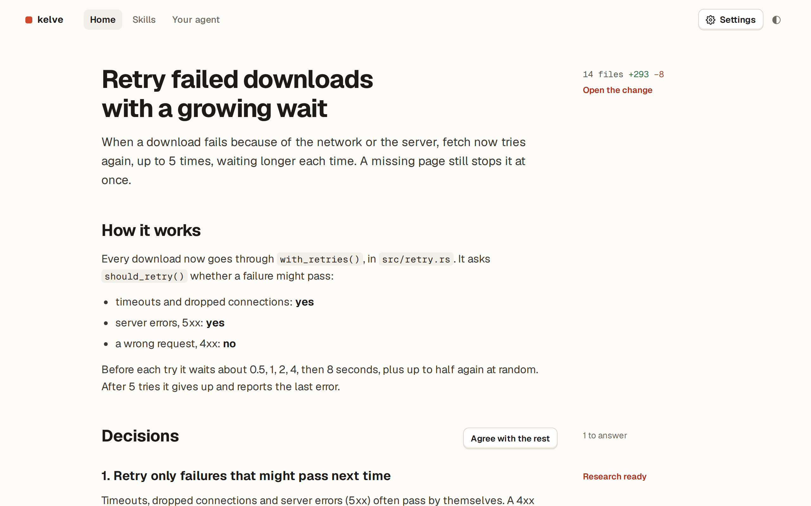
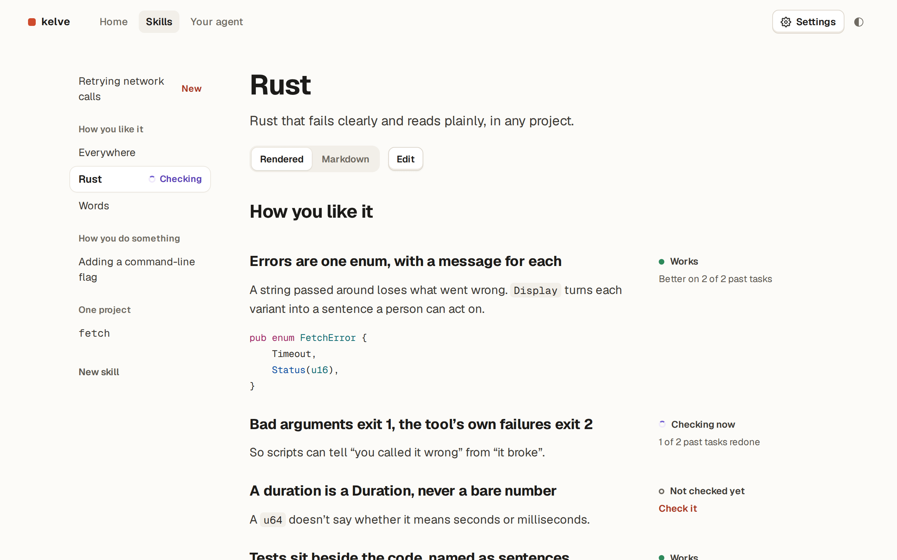
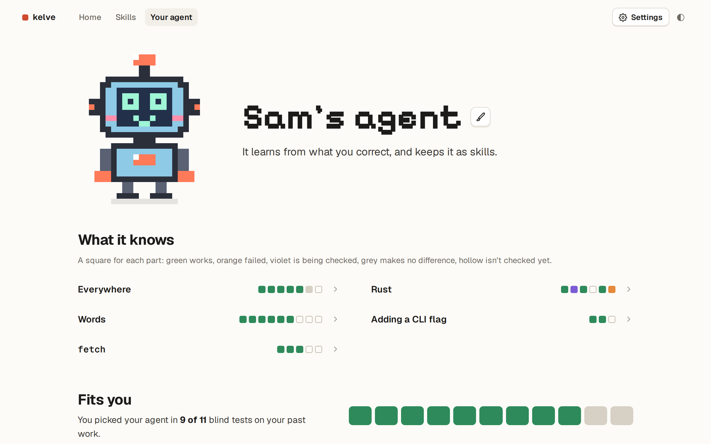

<h1 align="center">
  <picture>
    <source media="(prefers-color-scheme: dark)" srcset="brand/logo/lockup-dark.svg">
    
  </picture>
</h1>

<h3 align="center">Make your agent yours.</h3>

<p align="center">kelve turns what you know into skills your agents use, and proves they make your agent better.<br>It runs on your computer, with the agent you already use.</p>

<p align="center">
  <a href="https://kelve.ai/demo/#/example"><b>Try the example</b></a> ·
  <a href="https://kelve.ai">kelve.ai</a> ·
  <a href="https://kelve.ai/docs/">Docs</a>
</p>

Ask your agent:

```
Install kelve from kelve.ai/install.sh
```

Works with Claude Code, Codex, Cursor and other agents.

---

Everyone has the same models. What you know that the model doesn't is what makes your agent better than anyone else's. kelve catches it as you work, keeps it as skills, and checks that each part changes what your agent does.

## A debrief of every piece of work.

When your agent hands its work over, kelve asks it for a debrief, while it still remembers why: what it did, how it works, and every decision that matters, each with where it came from, what else it could have done, and its own lines. Agree, ask for it another way, or have your agent look into it. Ask it to explain an idea the work rests on, in the work's own terms.

<picture>
  <source media="(prefers-color-scheme: dark)" srcset=".github/assets/debrief-dark.png">
  
</picture>

Every file of the change is a click away, with each decision beside the lines it holds, and anything you changed after it was handed over marked as yours.

<picture>
  <source media="(prefers-color-scheme: dark)" srcset=".github/assets/change-dark.png">
  
</picture>

## Skills from what you correct.

kelve learns from what you tell your agent while it works, from what you change in its work after it hands over, and from the decisions you send from a debrief to be done that way every time. Each becomes a part of a skill: how you like it, how you do something, or what a project needs. They're standard `SKILL.md` files, yours alone, and you can edit them as you like.

<picture>
  <source media="(prefers-color-scheme: dark)" srcset=".github/assets/skills-dark.png">
  
</picture>

## Every agent gets them.

kelve's hook hands your skills to your agent at the moment they help: your general ones as a session starts, a kind of work's the first time it touches that kind of file. With your yes, they go in each agent's own skills folder too, so they work wherever you do.

## Each part is checked.

A part earns its place by changing what your agent does. kelve has your agent redo one of your past tasks twice, with the part and without, and compares each with what you kept. A part that makes no difference can go; one your agent still gets wrong is reworded. Fits you does the same with all your skills against none, and you pick the one you'd rather keep, blind.

## A score you can show.

On kelve.ai, your agent with your skills runs against a standard agent on the same model, on tasks nobody sees in advance, with hidden tests and a fixed judge. The result is yours to publish on your own page, beside your agent's character.

<picture>
  <source media="(prefers-color-scheme: dark)" srcset=".github/assets/agent-dark.png">
  
</picture>

## Yours, on your computer.

- **Nothing of yours leaves,** but your skills, to kelve.ai, for a verified run you ask for, with secrets and paths stripped and every file shown to you first. Your work, your messages and your edits never leave.
- **No model of its own.** Your agent does kelve's work, on the plan you already have.
- **Nothing to sign up for.** You need an account on kelve.ai only for verified scores and your page.
- **Open source.** Apache 2.0. Read every line of it.

## Start

Ask your agent:

```
Install kelve from kelve.ai/install.sh
```

Start it again if it needs to, and ask it:

```
Open kelve.
```

Your first debrief comes when it next hands over work. To have one for any work, ask it:

```
Debrief this in kelve.
```

<details>
<summary>Install it yourself</summary>

<br>

Run the installer in a terminal. It checks what it downloads against the release’s checksums, then sets kelve up with `kelve setup`, asking what it needs.

macOS and Linux, into `~/.local/bin`:

```sh
curl -fsSL https://kelve.ai/install.sh | sh
```

Windows, into `%LOCALAPPDATA%\kelve\bin`, added to your PATH:

```powershell
irm https://kelve.ai/install.ps1 | iex
```

From source, with Rust and Bun:

```sh
git clone https://github.com/kelve-ai/kelve
cd kelve/web && bun install && bun run build && cd ..
cargo install --path crates/cli --locked
kelve setup
```

Then start a new session with your agent, so it has kelve’s tools, and ask it: “Open kelve.”

</details>

## Docs

- **[kelve’s docs](https://kelve.ai/docs/)**, on kelve.ai: installing kelve, using it with your agent, and what it does with your work. To start: [install](https://kelve.ai/docs/install/), [connect your agent](https://kelve.ai/docs/connect/) and [what goes where](https://kelve.ai/docs/what-goes/).
- [The design](docs/skills.md), [how kelve is built](docs/architecture.md), [developing it](docs/developing.md), [its settings](docs/self-hosting.md) and [releasing it](docs/releasing.md).
- [Contributing](CONTRIBUTING.md), [working on kelve with agents](AGENTS.md) and [reporting a security problem](SECURITY.md).

## License

Apache 2.0 ([what it allows](docs/license.md)). The kelve name and logo aren’t covered by it: [using them](brand/README.md). Questions: hello@kelve.ai.
